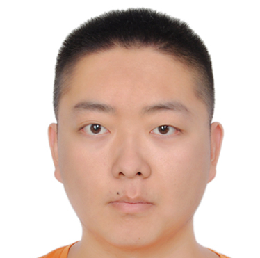

Wenjie Zhang (张文杰) is currently a postdoc (Research Fellow) in [National University in Singapore](https://www.comp.nus.edu.sg/) advised by Prof. [Yun Lin](http://linyun.info/) and Prof. [Jinsong Dong](https://www.comp.nus.edu.sg/cs/people/dongjs/). Wenjie Zhang was a Ph.D. student advised by Prof. [Lu Zhang]() and Prof. [Yingfei Xiong](https://xiongyingfei.github.io/) in [Institute of Software](https://www.sei.pku.edu.cn/), [School of Computer Science](https://cs.pku.edu.cn/English/Home.htm), [Peking University](https://english.pku.edu.cn/) and graduated in July 2024.

<div style="text-align: center;"></div>

Office: Security Lab, Room 2-18, COM3, School of Computing, National University of Singapore, Singapore, 117417

Email: wjzhang AT nus DOT edu DOT sg

<h3>Research Interests</h3>

- Web Security
- Web Constraints Learning
- Constraint Solving
- Compilation Error Fixing
- Code Generation
- Code Representation

<h3>Publications</h3>

- **Wenjie Zhang**, Yun Lin, Chun Fung Amos Kwok, Xiwen Teoh, Xiaofei Xie, Frank Liauw, Hongyu Zhang, Jin Song Dong, MINES: Explainable Anomaly Detection through Web API Invariant Inference, ICSE (CCF-A), 2026, [Link](https://www.arxiv.org/abs/2512.06906).
- Yakun Zhang, **Wenjie Zhang**, Dezhi Ran, Qihao Zhu, Chengfeng Dou, Dan Hao, Tao Xie, Lu Zhang, Learning-based Widget Matching for Migrating GUI Test Cases, ICSE (CCF-A), 2024, [Link](https://dl.acm.org/doi/10.1145/3597503.3623322).
- **Wenjie Zhang**, Guancheng Wang, Junjie Chen, Yingfei Xiong, Yong Liu, Lu Zhang, OrdinalFix: Fixing Compilation Errors via Shortest-Path CFL Reachability, ASE (CCF-A), 2023, [Link](https://arxiv.org/abs/2309.06771).
- Qihao Zhu, Zeyu Sun, **Wenjie Zhang**, Yingfei Xiong, Lu Zhang, Tare: Type-Aware Neural Program Repair, ICSE (CCF-A), 2023, [Link](https://xiongyingfei.github.io/papers/ICSE23a.pdf).
- Qingyuan Liang, Zeyu Sun, Qihao Zhu, **Wenjie Zhang**, Lian Yu, Yingfei Xiong, Lu Zhang, Lyra: A Benchmark for Turducken-Style Code Generation, IJCAI-ECAI (CCF-A), 2022, [Link](https://arxiv.org/abs/2108.12144).
- Qihao Zhu, Zeyu Sun, **Wenjie Zhang**, Yingfei Xiong, Lu Zhang, Grape: Grammar Preserving Rule Embedding, IJCAI-ECAI (CCF-A), 2022, [Link](https://www.ijcai.org/proceedings/2022/631).
- Qingyuan Liang, Qihao Zhu, Zeyu Sun, Lu Zhang, Zhang Wenjie, Yingfei Xiong, Guangtai Liang, Lian Yu, A Survey on SQL Generation Based on Deep Learning, Science in China: Information Sciences (Chinese), Vol. 52, No. 8, pp. 1363-1392, 2022.
- Jinhao Dong, Yiling Lou, Qihao Zhu, Zeyu Sun, Zhilin Li, **Wenjie Zhang**, Dan Hao, FIRA: Fine-Grained Graph-Based Code Change Representation for Automated Commit Message Generation, ICSE (CCF-A), 2022, [Link](https://dl.acm.org/doi/abs/10.1145/3510003.3510069).
- Zeyu Sun, **Wenjie Zhang**, Lili Mou, Qihao Zhu, Yingfei Xiong, Lu Zhang, Generalized Equivariance and Preferential Labeling for GNN Node Classification, AAAI (CCF-A), 2022, [Link](https://arxiv.org/abs/2102.11485).
- Qihao Zhu, Zeyu Sun, Yuan-an Xiao, **Wenjie Zhang**, Kang Yuan, Yingfei Xiong, Lu Zhang, A Syntax-Guided Edit Decoder for Neural Program Repair, ESEC/FSE (CCF-A), 2021, [Link](https://arxiv.org/abs/2106.08253).
- **Wenjie Zhang**, Zeyu Sun, Qihao Zhu, Ge Li, Shaowei Cai, Yingfei Xiong, Lu Zhang, NLocalSAT: Boosting Local Search with Solution Prediction, IJCAI (CCF-A), 2020, [Link](https://arxiv.org/abs/2001.09398).
- Shangbang Long, Jiaqiang Ruan, **Wenjie Zhang**, Xin He, Wenhao Wu, Cong Yao, Shangbang Long, Jiaqiang Ruan, Wenjie Zhang, Xin He, Wenhao Wu, Cong Yao, TextSnake: A Flexible Representation for Detecting Text of Arbitrary Shapes, ECCV (CCF-B), 2018, [Link](https://arxiv.org/abs/1807.01544).

<h3>Academic Services</h3>

Reviewer for Journals

- TSE, TOSEM

<h3>Honors & Awards</h3>

- 2020, Merit Student, Peking University
- 2022, Excellent Research Award, Peking University

<h3>Education</h3>
- 2019 - 2024, Ph.D. Student, Computer Science, [Peking University](https://english.pku.edu.cn/)
- 2015 - 2019, Bachelor, Physics, [Peking University](https://english.pku.edu.cn/)

<h3>Working Experience</h3>
- 2024 - Now, Postdoctoral Research Fellow, [National University of Singapore](https://www.comp.nus.edu.sg/)

<h3>GPG Key</h3>
```
-----BEGIN PGP PUBLIC KEY BLOCK-----

mDMEaqUUPRYJKwYBBAHaRw8BAQdAsxxVevD6LCvRBURhX6M/RVn7csjvMuCo0HPB
pAZE/zW0IVdlbmppZSBaaGFuZyA8d2p6aGFuZ0BudXMuZWR1LnNnPoiQBBMWCgA4
FiEErKEp31/SmOuWJsywlxLXFhbwaVAFAmqlFMsCGwMFCwkIBwIGFQoJCAsCBBYC
AwECHgECF4AACgkQlxLXFhbwaVApcAD+LwVx+FvlIjRqEt+vhwMOBWEjJ0Q6OrF+
NHH4lxnUmPoBAIxPNK6XNhrE7/vu1AeerW8bh1MyHmueayiEc42MRAwAtCNXZW5q
aWUgWmhhbmcgPHdlbmppZXo2OTZAZ21haWwuY29tPoiQBBMWCgA4FiEErKEp31/S
mOuWJsywlxLXFhbwaVAFAmqlFD0CGwMFCwkIBwIGFQoJCAsCBBYCAwECHgECF4AA
CgkQlxLXFhbwaVBXIgD/aGRH8gJiP4rN6Iwl+jLIoXC73o8Tm1dpy6d6ewIUapYB
APgVbzPVgyQN1kxcuEeqUAH5iF4K2yxZpLTQBCgwb3oLtCVXZW5qaWUgWmhhbmcg
PHpoYW5nd2oxOTk3QGljbG91ZC5jb20+iJAEExYKADgWIQSsoSnfX9KY65YmzLCX
EtcWFvBpUAUCaqUUmgIbAwULCQgHAgYVCgkICwIEFgIDAQIeAQIXgAAKCRCXEtcW
FvBpUDJfAP43Ecvqj8PbBTN8F4+iAKIw1UApiVQZsW9FFG1e1zLzhgD/es4E7s+r
rCmNA3Ic8j/DzHrl4g7OJ1qOXX/zKjnV5A+0IFdlbmppZSBaaGFuZyA8MTAzNjIw
MDAzNUBxcS5jb20+iJAEExYKADgWIQSsoSnfX9KY65YmzLCXEtcWFvBpUAUCaqUU
swIbAwULCQgHAgYVCgkICwIEFgIDAQIeAQIXgAAKCRCXEtcWFvBpUAfFAQCwRxxg
g580G3yzsW1ql7pFwEVvuSrxFF5wtb5Lch3xUwEAnujxFjOgtmL33CbPxufFwWBj
eRjIE+fiaLtBTiCXewu0J1dlbmppZSBaaGFuZyA8emhhbmdfd2VuX2ppZUBwa3Uu
ZWR1LmNuPoiQBBMWCgA4FiEErKEp31/SmOuWJsywlxLXFhbwaVAFAmqlFMACGwMF
CwkIBwIGFQoJCAsCBBYCAwECHgECF4AACgkQlxLXFhbwaVD5pQD/cMhXujQwpTRm
62sVz1eCm48XnMZ+12bawOKzcmJzyLMA/iNMhXaOoI8GiZCPgylpT/tKkwbTezT2
eQUOFMo0Gy8GtChXZW5qaWUgWmhhbmcgPG1vZXNha3VyYTE5OTdAb3V0bG9vay5j
b20+iJAEExYKADgWIQSsoSnfX9KY65YmzLCXEtcWFvBpUAUCaqUVEAIbAwULCQgH
AgYVCgkICwIEFgIDAQIeAQIXgAAKCRCXEtcWFvBpUHvwAPoDwzN8pxy/Lo+2OIzq
Qw5XGzDdyK1tmqQH7aLoCVVV5QEAwtDfBqPDrcvFc6MHEZ4Cq+D+LZOC/0BYunut
ux3V3Q64OARqpRQ9EgorBgEEAZdVAQUBAQdAJ3SaKjTWfbbhx69UOTd5kzG+CGvg
JOsDk5uJlrPnX3wDAQgHiHgEGBYKACAWIQSsoSnfX9KY65YmzLCXEtcWFvBpUAUC
aqUUPQIbDAAKCRCXEtcWFvBpUPoCAPkBZQurDJ6i6OK7W25BwoFxEOb9GPinuati
r+QN9dgMQwEA+KdDIWq+Tzpj4J3YTuANV0v8830/ZwKx124g3/1HAg0=
=MzZj
-----END PGP PUBLIC KEY BLOCK-----
```
